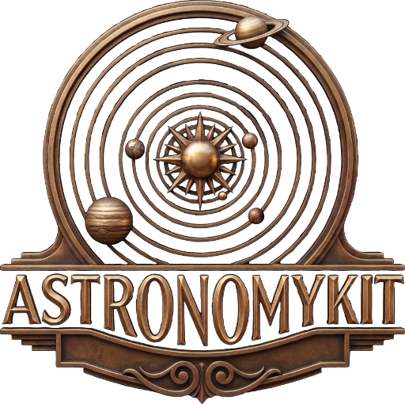

<p align="center">
  
</p>

# AstronomyKit

AstronomyKit is a 100% pure Swift 6 library based on Don Cross' [Astronomy Engine](https://github.com/cosinekitty/astronomy) C library, with zero C dependencies, Swift 6 strict concurrency, and full `Sendable` conformance. It calculates positions of the Sun, Moon, planets, and fixed stars, and predicts moon phases, eclipses, transits, and rise/set times on-device. Positions are accurate to ±1 arcminute using VSOP87 and NOVAS C 3.1 models validated against JPL Horizons.

[](https://swift.org)
[](https://swift.org)
[](LICENSE)
[](https://heirloomlogic.github.io/AstronomyKit/documentation/astronomykit/)

## Features

- Positions and ecliptic velocities for the Sun, Moon, planets, and Jupiter's moons
- Moon phase angles, quarters, illumination, and libration
- User-defined fixed stars from J2000 catalog coordinates
- Gravity-simulated position for 2060 Chiron
- Rise, set, and culmination times
- Lunar and solar eclipse predictions
- Equinoxes and solstices
- Coordinate transforms across equatorial, ecliptic, horizon, and galactic systems
- Planetary conjunctions, oppositions, and relative longitude search
- Apsides, elongation, and transits
- Generic root-finding search and light-travel correction for custom events
- 100% pure Swift 6 with zero C dependencies and full `Sendable` conformance

## Supported dates

Positions, states, distances, and the searches built on them accept a Terrestrial Time within 4,000 Julian years of J2000, roughly the years −2000 to +6000, and throw `AstronomyError.badTime` outside it. Pluto's range is narrower, about the years −100 to +4100. See "Accepted Range" in the `AstroTime` documentation.

## Installation

### Swift Package Manager

Add to your `Package.swift`:

```swift
dependencies: [
    .package(url: "https://github.com/heirloomlogic/AstronomyKit", from: "4.3.0")
]
```

Or in Xcode: **File → Add Package Dependencies** and enter the repository URL.

## Quick Start

```swift
import AstronomyKit

// Your location
let observer = Observer(latitude: 40.7128, longitude: -74.0060)  // NYC

// Current moon phase
let angle = try Moon.phaseAngle(at: .now)
print("\(Moon.emoji(for: angle)) \(Moon.phaseName(for: angle))")

// Next sunrise
if let sunrise = try CelestialBody.sun.riseTime(after: .now, from: observer) {
    print("Sunrise: \(sunrise.date)")
}

// Where is Mars?
let mars = try CelestialBody.mars.horizon(at: .now, from: observer)
print("Mars: \(mars.altitude)° \(mars.compassDirection)")
```

## Usage

### Time

```swift
// Current time
let now = AstroTime.now

// From components
let time = AstroTime(year: 2025, month: 6, day: 21, hour: 12)

// From Foundation Date
let time = AstroTime(Date())

// Time arithmetic
let tomorrow = now.addingDays(1)
let nextHour = now.addingHours(1)
```

### Observer Location

```swift
let seattle = Observer(latitude: 47.6062, longitude: -122.3321)
let denver = Observer(latitude: 39.7392, longitude: -104.9903, height: 1609)

// Built-in
let greenwich = Observer.greenwich
```

### Celestial Bodies

```swift
// Available bodies
let planets = CelestialBody.planets  // Mercury through Neptune (excluding Earth)
let galileanMoons = CelestialBody.galileanMoons  // Io, Europa, Ganymede, Callisto

// Body properties
print(CelestialBody.mars.name)           // "Mars"
if let period = CelestialBody.mars.orbitalPeriod {
    print("\(period) days")              // ~686 days
}
```

### Position Calculations

```swift
// Horizon coordinates (altitude/azimuth)
let horizon = try CelestialBody.jupiter.horizon(at: .now, from: observer)
print("Altitude: \(horizon.altitude)°")
print("Azimuth: \(horizon.azimuth)° (\(horizon.compassDirection))")

// Equatorial coordinates (RA/Dec)
let eq = try CelestialBody.saturn.equatorial(at: .now)
print("RA: \(eq.rightAscensionFormatted)")   // "02h 15m 30.2s"
print("Dec: \(eq.declinationFormatted)")     // "+12° 34' 56.7""

// Distance from Sun
let au = try CelestialBody.mars.distanceFromSun(at: .now)
```

### Moon Phases

```swift
// Current phase
let angle = try Moon.phaseAngle(at: .now)
print(Moon.phaseName(for: angle))     // "Waxing Gibbous"
print(Moon.emoji(for: angle))         // "🌔"
print(Moon.illumination(for: angle))  // 0.0 to 1.0

// Find specific phases (nil if not found within the search window)
if let nextFull = try Moon.searchPhase(.full, after: .now) {
    print("Next full moon: \(nextFull)")
}

// All quarters in January 2025
let quarters = try Moon.quarters(
    from: AstroTime(year: 2025, month: 1, day: 1),
    to: AstroTime(year: 2025, month: 2, day: 1)
)
```

### Fixed Stars

```swift
// Define a star from J2000 catalog coordinates
let algol = FixedStar(
    name: "Algol",
    rightAscension: 3.136148,  // Right ascension in hours
    declination: 40.9556,      // Declination in degrees
    distance: 92.95    // Distance in light-years
)

// Ecliptic longitude (true ecliptic and equinox of date, same frame as the planets)
let longitude = try algol.eclipticLongitude(at: .now)
print("Algol is at \(longitude)°")

// Horizon coordinates
let horizon = try algol.horizon(at: .now, from: observer)
print("Algol: \(horizon.altitude)° altitude")
```

### Chiron

```swift
// Chiron's ecliptic longitude (commonly used in astrology)
let longitude = try Chiron.eclipticLongitude(at: .now)
print("Chiron is at \(longitude)°")

// Full ecliptic coordinates
let ecliptic = try Chiron.ecliptic(at: .now)
print("Longitude: \(ecliptic.longitude)°, Latitude: \(ecliptic.latitude)°")

// Horizon position for an observer
let horizon = try Chiron.horizon(at: .now, from: observer)
print("Chiron altitude: \(horizon.altitude)°")
```

### Rise/Set Times

```swift
let sunrise = try CelestialBody.sun.riseTime(after: .now, from: observer)
let sunset = try CelestialBody.sun.setTime(after: .now, from: observer)
let moonrise = try CelestialBody.moon.riseTime(after: .now, from: observer)

// Upper culmination (transit)
let transit = try CelestialBody.sun.culmination(after: .now, from: observer)
print("Max altitude: \(transit.horizon.altitude)°")
```

### Seasons

```swift
let seasons = try Seasons.forYear(2025)
print("Spring: \(seasons.marchEquinox)")
print("Summer: \(seasons.juneSolstice)")
print("Autumn: \(seasons.septemberEquinox)")
print("Winter: \(seasons.decemberSolstice)")
```

### Eclipses

```swift
// Next lunar eclipse
let lunar = try Eclipse.searchLunar(after: .now)
print("\(lunar.kind.name) lunar eclipse at \(lunar.peak)")

// Next solar eclipse
let solar = try Eclipse.searchGlobalSolar(after: .now)
if solar.kind == .total, let lat = solar.latitude, let lon = solar.longitude {
    print("Total solar eclipse visible at \(lat)°, \(lon)°")
}

// All eclipses in 2025
let eclipses = try Eclipse.lunarEclipses(
    from: AstroTime(year: 2025, month: 1, day: 1),
    to: AstroTime(year: 2026, month: 1, day: 1)
)
```

### Conjunctions and Oppositions

```swift
// When is Mars next at opposition? (closest to Earth, brightest)
let opposition = try CelestialBody.mars.searchOpposition(after: .now)
print("Mars opposition: \(opposition.date)")

// When is Jupiter next in superior conjunction? (behind the Sun)
let conjunction = try CelestialBody.jupiter.searchSuperiorConjunction(after: .now)
print("Jupiter conjunction: \(conjunction.date)")

// Relative ecliptic longitude between two bodies
let angle = try CelestialBody.venus.pairLongitude(with: .mars, at: .now)
print("Venus-Mars separation: \(angle)°")
```

## API Reference

| Type | Description |
|------|-------------|
| `Apsis` | Perihelion/aphelion or perigee/apogee events |
| `AstronomyConfig` | Ephemeris version, Delta T model selection, and cache reset |
| `AstronomyError` | Error cases thrown by calculation and search APIs |
| `AstroSearch` | Generic root-finding search and light-travel correction |
| `AstroTime` | Time representation with UT/TT and `Date` conversion |
| `Atmosphere` | Standard atmosphere pressure, temperature, and density by elevation |
| `CelestialBody` | Enum of Sun, Moon, planets, barycenters, and Galilean moons |
| `Chiron` | Gravity-simulated position for 2060 Chiron |
| `Constellation` | IAU constellation lookup from celestial coordinates |
| `DailyEvents` | Combined rise, set, and culmination times for one day |
| `Eclipse` | Lunar, global solar, and local solar eclipse searches |
| `Ecliptic` | Ecliptic longitude, latitude, and distance coordinates |
| `EclipticState` | Geocentric ecliptic position and velocity in true ecliptic of date |
| `Elongation` | Angular separation from the Sun and morning/evening visibility |
| `Equatorial` | Right ascension and declination coordinates |
| `FixedStar` | Stateless value type for user-defined stars from J2000 coordinates |
| `GlobalSolarEclipse` | Solar eclipse with peak shadow location |
| `GravitySimulation` | N-body gravity simulation |
| `Horizon` | Altitude and azimuth for local sky position |
| `Illumination` | Visual magnitude, phase fraction, and Saturn ring tilt |
| `Jupiter` | Galilean moon state calculations |
| `JupiterMoons` | State vectors for Io, Europa, Ganymede, and Callisto |
| `LagrangePoint` | L1–L5 point calculations |
| `Libration` | Lunar libration angles, distance, and apparent diameter |
| `LocalSolarEclipse` | Solar eclipse timing and visibility from an observer |
| `LunarEclipse` | Lunar eclipse event with peak time and phase semi-durations |
| `LunarNode` | Ascending and descending lunar node crossings |
| `Moon` | Lunar phase angles, quarters, position, libration, nodes, and apsides |
| `MoonPhase` | Lunar phase enum (new, first quarter, full, third quarter) |
| `Observer` | Geographic location (latitude, longitude, height) |
| `RotationAxis` | Planetary north pole orientation and prime meridian spin |
| `RotationMatrix` | 3×3 coordinate system transformations |
| `Seasons` | Equinox and solstice times for a calendar year |
| `Spherical` | Spherical coordinates (latitude, longitude, distance) |
| `StateVector` | 3D Cartesian position and velocity vector |
| `Sun` | Sun ecliptic position, velocity, and longitude search |
| `Transit` | Mercury and Venus solar transits |
| `Vector3D` | 3D Cartesian position vector in AU |

Supporting option and event types (`Aberration`, `ApsisKind`, `DeltaTModel`, `EclipseEvent`, `EclipseKind`, `EquatorDate`, `HourAngleEvent`, `LagrangePointID`, `MoonQuarter`, `NodeKind`, `Refraction`, `RiseSetDirection`, `Visibility`) are documented in the [DocC reference](https://heirloomlogic.github.io/AstronomyKit/documentation/astronomykit/).

## Beyond Astronomy Engine

AstronomyKit includes features not present in upstream Astronomy Engine:

| Feature | Description |
|---------|-------------|
| `Chiron` | Gravity-simulated positions for 2060 Chiron using pre-computed JPL Horizons state vectors at reference epochs (2000–2040). Astronomy Engine has no built-in Chiron support. |
| `EclipticState` | Geocentric ecliptic position and five-point Terrestrial Time derivative (`longitudeRate`, `latitudeRate`, `distanceRate`) in the true ecliptic and equinox of date. |
| `FixedStar` | Stateless, thread-safe value type for user-defined stars from J2000 catalog coordinates. |

All other AstronomyKit types port Astronomy Engine's algorithms directly to Swift.

## Documentation

DocC documentation is available. The DocC plugin is dev-gated behind `.dev-tooling`; build it locally with:

```bash
touch .dev-tooling
swift package generate-documentation --target AstronomyKit
```

Or in Xcode: **Product → Build Documentation**

## Requirements

**Runtime:** Swift 6.0+, macOS 15+ / iOS 18+ / tvOS 18+ / watchOS 11+ / Linux.

**Development:** Xcode 26.3 (Swift 6.3). The swift-format build tool plugin is pinned to a toolchain; see [Toolchain Alignment](#toolchain-alignment).

## Toolchain Alignment

The swift-format build tool plugin is pinned to a specific toolchain version. To contribute, your local toolchain must match CI:

| Context | Toolchain |
|---------|-----------|
| **Consumers** (SPM dependency) | Swift 6.0+ — any compatible toolchain |
| **Contributors** (building from source) | Xcode 26.3 / Swift 6.3 — must match CI |

The format plugin is **dev-gated** and does not ship to consumers: it only resolves when a gitignored `.dev-tooling` sentinel is present. Run `touch .dev-tooling` once before building from source to enable it (see [CONTRIBUTING](CONTRIBUTING.md#code-style)). With it enabled, if your toolchain doesn't match, `swift build` will surface lint errors from the format plugin — update Xcode or install the matching Swift toolchain before submitting a PR.

## Built With AstronomyKit

- **[Fallow](https://heirloomlogic.com/fallow)** — Lunar fasting companion. Calculates Ekadashi and moon cycle timing.
- **[Edict](https://heirloomlogic.com/edict)** — Electional astrology planner. Scans planetary positions to find timing windows for decisions.

## Contributing

Contributions are welcome. See [CONTRIBUTING.md](CONTRIBUTING.md) for guidelines.

## Credits

- [Astronomy Engine](https://github.com/cosinekitty/astronomy) by Don Cross — the original C library whose algorithms and tables AstronomyKit ports (see [THIRD_PARTY_NOTICES](THIRD_PARTY_NOTICES))

## License

MIT License. See [LICENSE](LICENSE) for details.
